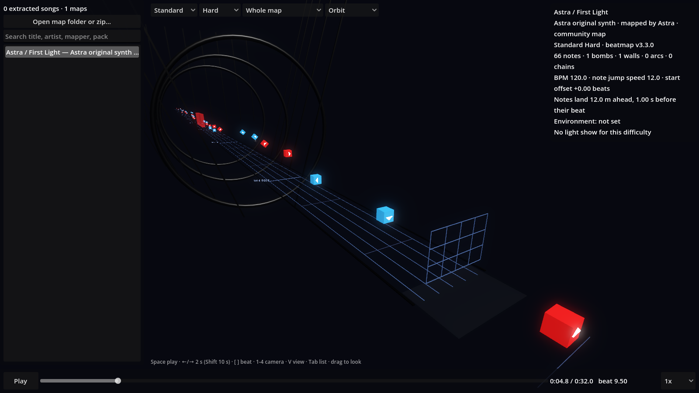
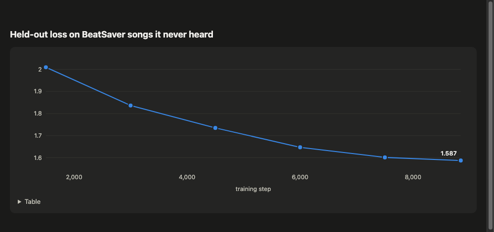
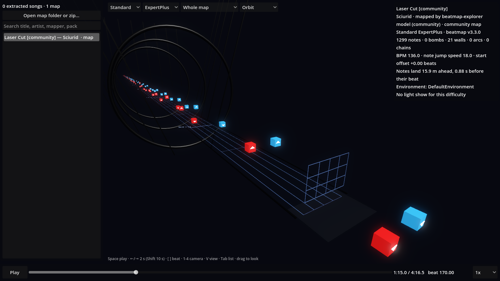
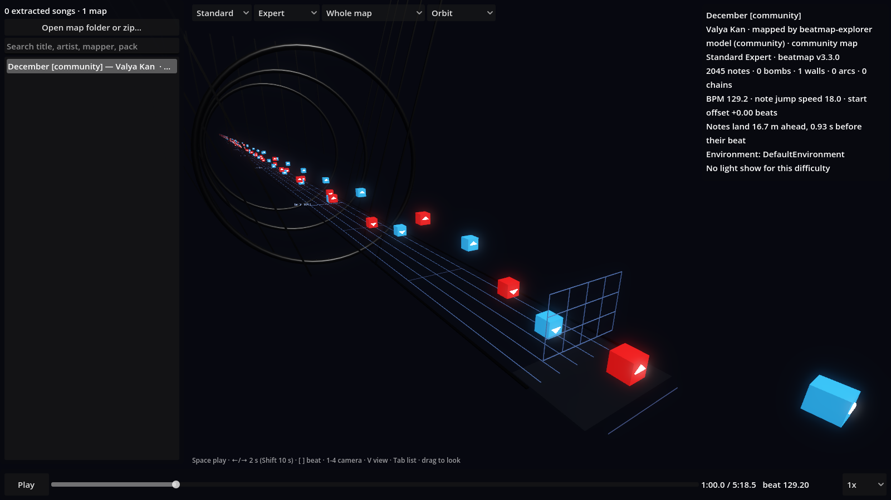

# Beatmap Explorer

Look at Beat Saber maps in 3D. Every note, bomb, wall, arc and chain is placed
where the map puts it, at the distance the player meets it, and the song plays
along while you scrub, slow down, orbit or watch from the player's spot.



It opens:

- **Community maps**: any map folder or `.zip` (Info.dat v2 or v4; beatmap
  v2, v3 or v4). Drop it on the window, click *Open*, or keep a folder of them.
- **Your own songs from the game**: `mapkit` copies the song files of *your*
  copy of the game off your Quest over adb, unpacks them, and indexes them.

No songs, maps or game files come with this project.

## Quick start

1. Install [Godot](https://godotengine.org/download) 4.4 or newer (tested with 4.8 beta 3).
2. **Community maps:** double-click `Open Beatmap Explorer.command` (macOS) or
   run `./run.sh`, then drop map folders or zips onto the window. To have them
   listed every time, put them in `library/community/` (or list your own
   folders in `config.json`). On Windows, open `viewer/project.godot` in Godot.
3. **Songs from your Quest:** connect the headset by USB with developer mode on,
   then double-click `Get Songs From Quest.command` (or `python3 mapkit.py all`).
   Accept the USB debugging prompt inside the headset if it asks. This needs
   Python 3 and adb (macOS: `brew install android-platform-tools`); the one
   Python package it uses is set up in `.venv` the first time.

## In the viewer

- Pick a song, then the characteristic (Standard, One Saber, No Arrows, 360°,
  90°, Legacy, ...) and the difficulty.
- **Whole map** lays out the entire difficulty. **As the player sees it** shows
  only what has landed on the lane, using the game's note jump formula.
- Cameras: player view (on 360°/90° maps it turns to the lane of the next note),
  orbit, side, top. Drag to look or orbit, right-drag to pan, wheel to zoom.
- Keys: Space play/pause · ←/→ 2 s (Shift 10 s) · `[` `]` one beat · 1-4 camera ·
  V view · Tab song list.
- The info panel shows note jump speed, landing distance, environment and light
  cues. Newer light shows also get a board that lights up each light group.
- **Maps side by side:** compare several maps of one song (the real one, a
  model's, another automapper's) in lanes beside each other, on one clock and
  one note spacing, so the same moment sits on the same line in every lane.
  Use "Add a map beside…", drop a map with Shift held, or start with
  `./run.sh --open=REAL --beside=MAP2 --beside=MAP3 --names="Real,Model,Other"`.
  The player camera then steps back to see every lane.

## mapkit

```
python3 mapkit.py all             pull from the Quest, extract, index (one step)
python3 mapkit.py pull            copy the game's song files and custom maps off the Quest
python3 mapkit.py extract [SRC]   unpack levels from a pulled folder or a main .obb
python3 mapkit.py index           rebuild index.json and cover art
python3 mapkit.py zip LEVEL       export an extracted level as a standard map zip
python3 mapkit.py inspect BUNDLE [NAME]   list a Unity bundle's objects, or dump matching ones
python3 mapkit.py open [FLAGS]    open the viewer
```

- `pull --dry-run` shows the adb commands without touching the headset;
  `--serial` picks a headset when several are connected; custom maps found on
  the headset are copied to `library/community/quest/`.
- `extract --only a,b` limits the run to some levels; levels already extracted
  are skipped unless `--force`. A bundle that can't be read (protected, or not
  a level) is reported and skipped.
- `zip` writes every characteristic, difficulty and light show with the timing
  data, the song as Ogg (needs sox or ffmpeg) and the cover.

## Settings

Everything lives in `library/` by default. To change that, copy
`config.example.json` to `config.json`:

| Key | Meaning |
| --- | --- |
| `library` | where pulls, extracted levels, covers, caches and exports go |
| `community` | extra folders of community maps to list |
| `levels`, `bundles` | extra folders of already-extracted levels and game bundles |
| `godot`, `python`, `adb` | where those programs are, if not found on their own |

Paths may start with `~` or be relative to this folder. `config.json`,
`index.json` and `library/` are git-ignored.

## How exact is it?

- **Exact, from the files:** every object's beat and time (through the song's
  own sample-exact tempo data or the map's tempo changes), lane, layer, colour,
  cut direction, angle offset and lane rotation; walls' lane, width and length;
  chains' tail, slices and squish; note jump speed and offset; environment and
  colour scheme; light cue timing and colours. Distance along the lane is
  time × note jump speed.
- **Measured in the game:** lane centres at ±0.3 m and ±0.9 m, layer heights
  0.835, 1.383 and 1.885 m (player head at 1.67 m).
- **Approximate:** arc curve shapes (the authored directions and multipliers,
  not the game's own spline), wall heights (drawn on the note grid's rows), and
  light flash and fade timing. The light rig is a simple stand-in with one part
  per basic light type, not a game stage. Notes are shown where they are once
  they land, without the fly-in. Note speed changes (v4.1) are listed, not
  applied. Noodle/Chroma mod data is ignored.

## A trained map maker (results so far)

`train/` holds an audio-to-map model and everything around it: building the
dataset from BeatSaver, training on a rented GPU, generating maps, scoring them
on songs the model never heard, and opening the results here. See
[train/README.md](train/README.md).

**First run (2026-11-24):** a 26M-parameter model trained for 20 minutes on one
rented RTX 4090 (about $0.60), from 5,145 BeatSaver songs (14,821
difficulties) that the machine downloaded and prepared itself in 12 minutes.
The held-out loss on songs it never heard fell from 2.01 to 1.59.



On held-out BeatSaver maps (a small sample: 6 difficulties of 2 songs) it puts
33 % of notes at the mapper's moments within 30 ms (timing F1 0.33, colour F1
0.20), matches the mapper's note speed on 4 of 6, and makes almost no
same-direction swing errors. Its main fault so far: on unfamiliar music it
overfills, so maps are generated with guard rails (minimum time between a
hand's notes per difficulty, limits on walls and bombs). Full numbers:
[docs/results/index.html](docs/results/index.html).

Maps it made for songs it never heard, opened in Beatmap Explorer:


*Expert+ for "Laser Cut" by Sciurid (Illusory, Secret Centre, 2020; CC BY 4.0,
[archive.org/details/secretcentre](https://archive.org/details/secretcentre)).*


*Expert for "December" by Valya Kan (Yarn Audio, YARN020, 2018; CC BY 4.0,
[archive.org/details/yarn020](https://archive.org/details/yarn020)).*

Not yet: arcs, chains and lights, and longer training (this run used a sixth of
the dataset list for 20 minutes). The trained weights are not published: they
learned from community maps whose mappers keep their rights.

## Please note

This project contains no songs, maps or game files. Use `mapkit` only with a
copy of the game you own, for your own viewing, and keep what it extracts to
yourself: the songs and official maps are copyrighted, and unpacking the game's
files may be against its terms of use. Community maps belong to their mappers.

Not affiliated with or endorsed by Beat Games or Meta. Beat Saber is a
trademark of Beat Games.

## License

MIT, see [LICENSE](LICENSE).
